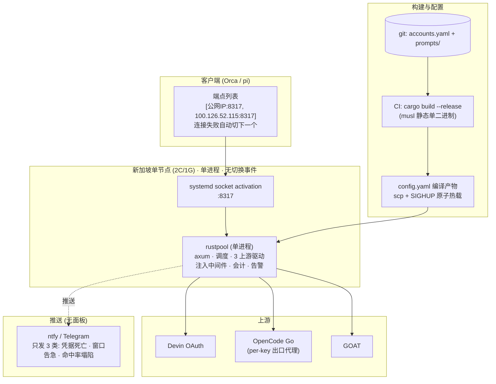
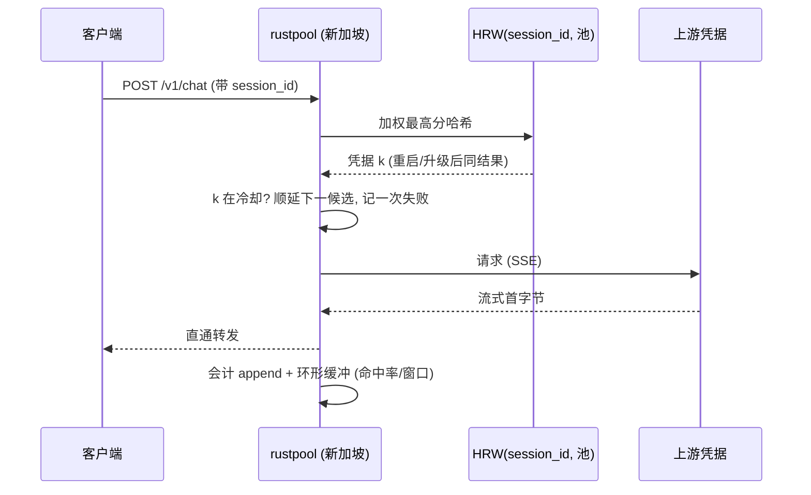
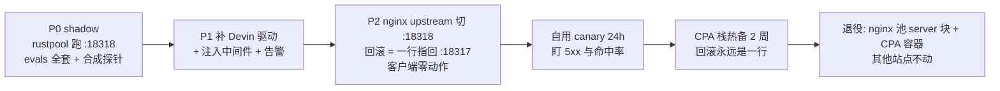

# 号池架构 v4：单二进制单节点网关

> 状态：设计稿，2026-11-19；2026-11-23 改为单节点基线。取代 v3 的"CPA 保留 + rustpoold 旁路控制面"方案。
> 两条输入决定方向：底层换成更稳、更前沿的自研架构；控制面删掉——使用者不看它。
> 落地设计规格见 [docs/rustpool-design.md](rustpool-design.md)。

## 0. v3 → v4：什么被推翻了

v3 的立场是"数据面保守（CPA 不动），控制面激进"。两条实测事实让这个立场站不住：

1. **不稳定恰恰来自 CPA 这层**。发行版跟随（v8 config 布局漂移，升级是风险事件）、亲和/冷却状态是进程本地的（重启即丢）、C-ABI 插件改动必须重启（断流）、单点。保留它等于把稳定性的钥匙放在别人的发布节奏里。
2. **控制面没有消费者**。调和器、DuckDB 分析面、面板、指标，全部是"给人看"的组件；使用者的实际行为是收推送、不看面板。监督系统的价值 = 查看频率 × 发现提前量，查看频率为零时，正确形态是进程内自感知 + 推送，不是外置观测栈。

v4 的原则：**稳定来自结构，不来自监督。** 部件数压到 1，共享状态压到 0，切换事件压到 0，控制面删除。

```text
v2 现状:  nginx + CPA + 2×C-ABI插件 + opencode2api + Docker + cron   → 6 个部件 6 个故障域, 701MB/967MB 内存
v3 方案:  上面的 6 个 + rustpoold + DuckDB + SQLite + Litestream    → 11 个部件, 更多
v4 方案:  rustpool ×1 (新加坡单机, 双路径入口) + systemd             → 1 种部件, ~60MB
```

### 0.1 规模前提（2026-11-23 补）

三条前提定死方案边界，也回答"为什么敢全自研"：

- **自用/小范围（2–10 人）**。Devin 白嫖窗口是个人杠杆：协议漂移砸下来的最坏情况是"这个池子先不用了"，不是"断一条业务线"——自研 Devin 驱动的维护期望由此封顶。小规模同时解锁一揽子豁免：单文件配置、无租户隔离、管理面只开 localhost、推送代替计费。
- **高效前沿**。数据面全 Rust（axum/tower/hyper/rustls/arc-swap/governor），SSE 零拷贝直通，per-凭据长连接池，单进程 ~60MB。前沿的边界同样写死：QPS<1 时 io_uring、thread-per-core 这类深水区技术是装饰，不进栈；前沿性落在形状上（无状态进程、函数化亲和、socket activation），不在孤立的技术名词上。
- **一台机器**。手上只有新加坡 2C/1G 这一台（Tailscale 100.126.52.115），设计按单机做。单服务器是当前事实与设计基线，不是降级模式；第二台是可选增量，加它时是"装二进制 + 端点列表加一行"，但设计不为它付当期成本。

Devin 驱动配一条逃生舱：上游驱动做成可插拔 trait，仓库常备一个 20 行 passthrough 驱动指向本地保留的 CPA 二进制。Devin 协议大改、自研没跟上时，一行配置切回 CPA 过渡，追平再切回——革命保留，尾部风险封死。

## 1. 总架构

拓扑只有一层：客户端 → 新加坡节点（rustpool）→ 三个上游（Devin、OpenCode Go、GOAT）。单服务器是当前事实与设计基线，不是降级模式；第二台机器是 P4 的可选项。



一个进程，两条入口：公网 IP 与 Tailscale IP，同一端口。公网路径不通时客户端自动改连 Tailscale（中继），公网恢复后再切回。观测到的不可达多数是网络路径问题——墙、运营商、机房网络——双路径覆盖了最常见的一整类故障，代价是客户端模板里多一行，不是第二台机器的钱。

被删除的 v2/v3 组件及替代物：

| 删除 | 功能去了哪 |
|---|---|
| CPA (Go) | rustpool 上游驱动 + 调度器 |
| opencode2api | opencode-go 驱动内的请求变换 |
| nginx | rustls 进程内 TLS + governor 限流 |
| Docker/Compose | systemd 直跑静态二进制，无镜像无守护 |
| jailbreak C-ABI 插件 | 原生 Rust 中间件，配置热载生效 |
| cron + record_usage.py | 进程内会计（每请求落 JSONL） |
| v3 的 rustpoold/DuckDB/面板/调和器 | 不替代——删除；deploy 收敛为一条命令 |

## 2. rustpool 内部

```text
rustpool (单二进制, musl 静态, ~60MB RSS)
├── 入口        axum 0.8 + hyper 1 + rustls (TLS 直收, :8317)
├── 限流        governor (GCRA, 进程内, 替代 nginx limit_req)
├── 鉴权        主 key / 客户端 key 列表, 常量时间比较
├── 中间件栈    tower Service 组合:
│     alias 还原 (-jailbreak/-nsfw 后缀剥离)
│     → 破甲注入 (profile 提示词, 语义照 docs/jailbreak.md)
│     → Devin 敏感词零宽混淆 (可选)
│     → 调度分发
├── 调度器      加权 HRW 哈希 (session→credential 纯函数)
│               + 本地冷却 (429/5xx 分级) + 5h 窗口计数
├── 上游驱动    devin (OAuth token 使用/刷新, 兼容读 auths/*.json 与 .cds)
│               opencode-go (per-key egress 代理 + 请求变换)
│               goat (openai-compat 直连)
│               SSE 直通: 边收边转发, 首字节即回写
├── 会计        环形缓冲 + 每请求 JSONL append (脱敏 key) + 3 条告警规则
├── 告警        进程内定时评估 → ntfy/Telegram 推送
├── 配置        arc-swap: SIGHUP → 解析 → 原子换指针, 进行中请求走旧配置
└── 管理        /healthz /config (仅 localhost) — 没有 CPAMC 面板
```

### 2.1 调度：为什么无状态反而更好

v2/v3 的会话亲和是 CPA 进程内的一张表——重启丢失、升级是一次状态销毁、要跨节点共享就得配故障转移编排。v4 换成纯函数：



- 亲和 = hash(session_id, credential_id) 的加权最高分。session→credential 不由进程内存表决定，重启、升级、SIGHUP 热载都不改映射，prompt cache 前缀天然保持（现状 98.5% cache read 的命根子）。
- 冷却：进程内学习，重启后从零开始。撞一次 429 就补回来，收敛代价 ≤2 个请求；额度的事实源本来就是上游，不是网关。
- 结果：没有亲和表、没有状态复制、没有 failover 事件。单机上 HRW 不是必需——一张进程内哈希表也能跑——差别在重启：表一丢，同一会话的下一轮请求落到别的凭据，prompt cache 前缀作废，命中率掉一截再慢慢爬回来。HRW 把这件事变成纯函数计算，重启零代价。
- 形状保留（零重构的那个理由）：调度器只读 (session_id, 凭据集合)，不读节点身份。加第二台机器的成本 = 装二进制 + 客户端端点列表加一行，调度器一行不改。对等形状保留的意义就是这条：未来第二台零重构，而不是现在就需要第二台。

### 2.2 可用性：分层清单

单机没有硬件冗余，这笔账写在明面上。可用性分五层，每层一个机制、一类它覆盖的故障：

- **进程层**：systemd `Restart=always` 兜进程崩溃；socket activation 兜升级——exec 期间新连接在 accept 队列排队，旧进程 graceful drain，客户端只感到一次稍慢的握手，不断流。
- **工件层**：部署产物 = 1 个静态二进制 + 1 个配置文件。冷备恢复 = 任意一台新机器 scp 两个文件 + `systemctl enable --now rustpool`，约 10 分钟。v2 的恢复要凑齐 nginx 站点、CPA 容器、两个 C-ABI 插件、opencode2api、cron 六件套，这里的恢复简单一个数量级。
- **上游层**：三个驱动分流。Devin 挂了 OpenCode Go 顶，Go 窗口耗尽 GOAT 顶。三个独立账号体系同时全挂的概率低于任何单台机器的故障率。
- **路径层**：同一台机器两个入口——公网 IP 与 Tailscale IP，同一端口 :8317，客户端端点列表 [公网IP:8317, 100.126.52.115:8317]，公网路径连不上自动改连 Tailscale 中继。
- **硬件层**：无冗余，诚实写。整机死亡 = 冷备 10 分钟恢复，期间不可用。接受这个风险：2C/1G 单机、日千级请求、2–10 个使用者可以等 10 分钟。

各机制的对照（同一份清单的实现细节与它修掉的 v2 痛点）：

| 机制 | 实现 | 修掉的 v2 痛点 |
|---|---|---|
| 零停机升级 | systemd socket activation：exec 期间新连接在 accept 队列等待，旧进程 graceful drain | 二进制升级 = 断流 |
| 一切热载 | SIGHUP + arc-swap 原子换配置（含破甲 profile、权重、密钥） | 插件/配置改动要重启 |
| 故障域 | 整机 1 个进程（Restart=always） | 6 个部件 6 个域 |
| 内存余量 | ~60MB vs 现状 701MB/967MB | OOM 余量 10 倍 |
| 无发行版跟随 | 升级节奏归自己，重启即原子切换 | CPA v8 布局漂移 |
| 客户端双路径 | 端点列表 [公网IP:8317, 100.126.52.115:8317]，TCP 连接失败自动下一个 | DNS/公网/墙/运营商单点 |
| 部署原子性 | 单文件 scp + SIGHUP；GET /config 即运行真相，diff 即审计 | 配置漂移（服务器跑未提交 glm-5.3 那次） |

## 3. 观测：只留推送，不留面板

使用者的行为模型是"出事找我，没事别烦"。全部观测收敛为进程内 3 条规则：

| 规则 | 触发 | 动作 |
|---|---|---|
| 凭据死亡/到期 | 探活 401/403，或 Devin token 距到期 ≤7 天 | 推送（唯一需要人工动作的事：轮换 token） |
| Go 窗口告急 | 5h 窗口用量 > 80% | 推送（补号决策） |
| 命中率塌陷 | 1h 滑窗 cache_read/input < 60% | 推送（亲和被打破 = 成本异常） |

会计数据仍然全量落 JSONL（脱敏），但没有任何查询面——需要查的时候 grep / python 一次脚本的事，不为"也许要看"常驻一套分析栈。

## 4. 可定制

| 想改什么 | 动哪里 | 生效 |
|---|---|---|
| 权重/冷却/窗口参数 | accounts.yaml → 编译 | scp + SIGHUP，秒级，零断流 |
| 破甲 profile / 提示词 | prompts/（注入逻辑是原生中间件） | 同上——v2 里要重启的事在 v4 是热载 |
| 新 openai-compat 上游 | accounts.yaml 加一段 | 同上 |
| 新 OAuth 类上游 | 加一个 driver 模块 | 发版（socket activation 零停机） |
| 告警阈值 | 配置文件 | 热载 |

deploy 是一条命令：`poolctl deploy` = 编译（本地或 CI）→ scp 二进制与配置 → SIGHUP。没有守护进程在后台调和——运行配置文件就是部署产物本身，GET /config 返回它，漂移检查是 `diff` 一条命令。

WASM 插件位（P5 按需，默认不做）：破甲注入可以做成 wasmtime 加载的 .wasm 组件，换提示词引擎不重编译二进制。先不做：原生中间件已覆盖需求，wasmtime 换来 15MB 体积与组件模型复杂度，等真出现"第三方写插件"的场景再开。

## 5. 技术选型

| 位置 | 选择 | 弃用 | 理由 |
|---|---|---|---|
| 框架 | axum 0.8 + hyper 1 + tower | Pingora | 需要完整请求体改写（注入中间件），tower 的 Service 组合就是这个形状；Pingora 为纯 L7 代理的 CDN 场景优化，正文变换不是它的强项 |
| TLS | rustls (+ rustls-acme, P5 按需) | nginx 终止 | 少一个进程；ACME DNS-01 进程内自动化 |
| 限流 | governor (GCRA) | nginx limit_req | 进程内，令牌桶语义等价 |
| 热配置 | arc-swap | etcd/任何配置中心 | 无锁指针换，读端零开销，无守护进程 |
| 运行时托管 | systemd + socket activation | Docker/k3s | 无镜像/注册表/容器运行时；静态 musl 二进制 scp 即部署 |
| 会计 | JSONL append + 文件滚动 | DuckDB/ClickHouse | 没有查询消费者；grep 够用 |
| 告警 | 进程内定时器 → ntfy | Prometheus/Grafana 全家 | 推送 3 条规则，不需要时序库 |
| 调度 | 自实现加权 HRW (~200 行) | CPA 调度器 | 纯函数、可单测、重启后一致（未来跨机也一致） |

## 6. 迁移：怎么在换发动机时不掉高度

替换的是活的生产链路，安全网分四层。P2 的切点是 nginx 的 upstream 行，不是客户端模板：客户端从 P0 到 P3 一直指着没变过的入口，所以每一次切换的回滚都是一行配置 + reload，客户端零动作。



移植清单（工作量大头，诚实估算）：

| 块 | 来源 | 估时 | 风险 |
|---|---|---|---|
| opencode-go + goat 驱动 | opencode2api 的变换逻辑（仓库内已有） | 3–4 天 | 低——纯 openai-compat，tests/ 可迁移 |
| 调度器 + 冷却 + 窗口 | CPA 语义 + docs 描述 | 2 天 | 低——纯函数，单测全覆盖 |
| 破甲注入中间件 | jailbreak-inject (Go) 按 docs/jailbreak.md 语义重写 | 2–3 天 | 中——注入语义有评测兜底（evals/） |
| Devin 驱动 | 读 CPA 上游源码，port OAuth 刷新与请求形状，兼容 auths/*.json + .cds | 2–5 天 | 最高——配 0.1 的逃生舱，一行配置可切回 CPA 过渡 |
| 会计 + 告警 + 部署命令 | record_usage.py 语义 | 1–2 天 | 低 |

总量 3–5 周（单人，非全职）。目标代码量 ≤5k 行 Rust——替换 6 个部件，这个预算内可审。

## 7. 路线图

| 期 | 范围 | 验收 | 估时 |
|---|---|---|---|
| P0 | rustpool 骨架：axum + 调度 + opencode-go/goat 驱动 + SSE 直通 + 会计；shadow :18318 | evals 全套通过；探针延迟与 CPA 持平（±20%） | ~1 周 |
| P1 | Devin 驱动 + 破甲注入 + 3 条告警 + deploy 命令 | canary 客户端跑 24h 无人工干预 | 1–2 周 |
| P2 | nginx upstream 切 :18318（回滚 = 一行指回 :18317，客户端零动作）；自用 canary 24h | 24h 内无 5xx 抬头、命中率不塌 | 半天 |
| P3 | 观察期：CPA 栈热备 2 周，一行可切回 | 两周零回滚 | 2 周（不占工时） |
| P4 | 退役：nginx 池相关 server 块下线（其他站点不动），rustpool 直接绑 :8317，客户端模板写双路径端点 [公网IP:8317, 100.126.52.115:8317]，CPA 容器停用（二进制/镜像留盘做逃生舱锚） | 直连 :8317 全量 48h；server 块下线前回滚仍是一行 | 半天 |
| P4（可选，另买机器才做） | 第二台：scp 静态二进制 + `systemctl enable --now` + 客户端端点列表加一行 | 零重构；冷起 ≤10 分钟 | 半天 |
| P5（按需） | WASM 插件位；渲染逻辑 Rust 化；ACME | — | 按需 |

## 8. 不做与边界

| 不做 | 理由 |
|---|---|
| 控制面/面板/指标库 | 无消费者；推送覆盖全部需要人响应的事件 |
| 共享状态存储 (Redis/etcd) | 单进程没有第二份状态要同步；HRW 是纯函数，未来加节点也不需要 |
| failover 编排 | 没有"切"这个事件——进程崩溃由 Restart=always 兜，升级由 socket activation 兜，路径故障由客户端端点列表兜 |
| WASM 插件（按需） | 原生中间件已覆盖；等第三方插件需求出现再开 |
| k8s/服务网格 | 无对应问题 |

边界声明：此设计为 2–10 用户、日千级请求优化。到 100+ QPS、多租户计费、或需要按 key 配额隔离时，重新评估调度与会计形态——那时加的是隔离层，不是推翻本架构。
