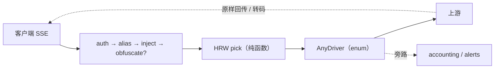
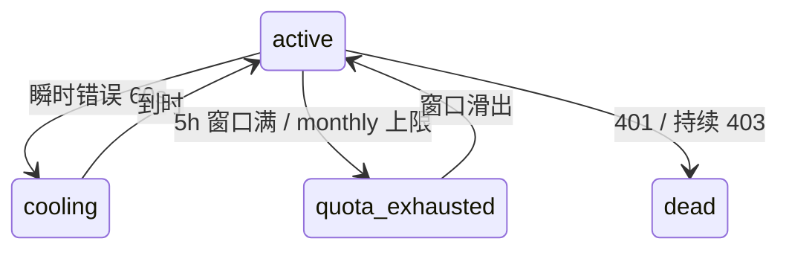

# rustpool 设计规格（v4 落地设计）

> 本文是 docs/architecture.md 的工程落地版：那边回答"为什么这样造"，这边回答"具体怎么造"。
> 目标：读完本文即可开工 P0（shadow :18318），途中不再需要新的架构决策。
> 状态：设计定稿 v1（2026-11-23）。悬而未决的事实问题集中在 §9 第 8 条，开工第一周从 CPA 源码定案。

## 0. 事实前提（继承 architecture.md §0.1）

自用 / 小范围（2–10 人）；一台服务器（新加坡，2C/1G）；QPS < 1，SSE 长流为主。
推论：内存预算 ~60MB；并发预算 < 100 连接；一切分布式 / 多租户 / 高吞吐机制不进栈。

## 1. 工件与代码预算

单 crate 单二进制，不拆 workspace——≤5k 行的量级拆了只增加跳转成本。

```text
src/
├── main.rs            # 启动、LISTEN_FDS 接管、SIGHUP、graceful drain
├── config.rs          # YAML → Arc<Config>；校验；arc-swap 热载
├── wire/
│   ├── anthropic.rs   # /v1/messages（?beta=true、beta 头透传、SSE）
│   ├── openai.rs      # /v1/chat/completions（SSE）
│   └── convert.rs     # Anthropic ↔ OpenAI 互转 + SSE 转码状态机
├── pipeline/
│   ├── auth.rs        # 客户端 key 校验（常时比较）
│   ├── alias.rs       # 别名还原 + profile 选择
│   ├── inject.rs      # 破甲注入：system 前插 + post_history reminder
│   └── obfuscate.rs   # Devin 零宽混淆（仅 devin 驱动）
├── scheduler/
│   ├── hrw.rs         # 加权 rendezvous（SipHash-1-3 固定键）
│   └── state.rs       # 冷却 / 5h 窗口（进程内存，Mutex<HashMap>）
├── drivers/
│   ├── mod.rs         # enum AnyDriver 分发（不用 dyn / async-trait）
│   ├── devin.rs       # OAuth（读 auths/*.json+.cds）+ 原生 API
│   ├── opencode_go.rs # 直连 opencode.ai/zen/go/v1，per-key 节流
│   ├── goat.rs        # OpenAI 兼容池
│   └── passthrough.rs # 逃生舱：转发 127.0.0.1:18317（退役 CPA）
├── probe.rs           # Go 余量探测：浏览器 UA + 退避 + 失效计数
├── accounting.rs      # 环形缓冲 + JSONL（脱敏）
├── alerts.rs          # 3 条推送（单 webhook）
└── health.rs          # /healthz、localhost /stats /config
```

| 模块 | 预算（行） | 说明 |
|---|---|---|
| main / health | ~200 | 启动、fd 接管、信号、健康面 |
| config | ~300 | 解析、校验、热载 |
| wire | ~700 | 两协议 + 转码状态机 |
| pipeline | ~400 | auth / alias / inject / obfuscate |
| scheduler | ~300 | HRW + 冷却 + 窗口 |
| drivers | ~1800 | devin 800（OAuth 移植占大头）、go 500、goat 150、passthrough 20、分发 300 |
| probe / accounting / alerts | ~500 | 旁路三件 |
| 合计 | ~4.2k | 对齐 ≤5k 行承诺 |

依赖：tokio、axum 0.8、hyper 1、rustls、arc-swap、serde、YAML 解析（serde_yml / yaml-rust2 二选一，标准：仍在维护）、siphasher、governor（仅 Go per-key 节流）、tracing。
明确不用：async-trait（enum 分发替代 dyn）、DashMap（Mutex 够用）、任何 DB / Redis / etcd。

## 2. 请求生命周期



1. **auth**：Authorization / x-api-key 对照 keys 列表，常时比较；失败 401，日志只记 hash。
2. **alias**：model 查别名表 → (driver, target, profile)；直通模型允许不配别名。
3. **inject**（有 profile 时）：profile 内容插到 system 段最前；post_history reminder 在最后一条 user 消息前再插提醒段。语义逐字复刻 v2 jailbreak-inject 插件，P0 用双面探针做逐字节 diff 验证。
4. **obfuscate**（仅 devin）：正文指定字段零宽混淆，算法逐字复刻 v2 插件。
5. **pick**：见 §4。
6. **driver**：构造上游请求（认证头 + convert）并发出。
7. **响应两模式**：
   - 同线协议（OpenAI 客户端 → OpenAI 上游）：hyper Body 原样回传——status、headers（剥 hop-by-hop）、chunk 边界全不动；计量用 Bytes 引用计数分叉（tee）喂旁路解析器，不复制不重组。
   - 跨线协议（Anthropic 客户端 → OpenAI 上游，现状主流量）：SSE 转码状态机，OpenAI delta → Anthropic 事件流，~200 行；转码异常降级为整体缓冲再吐，正确性优先于流式。
8. **classify**：驱动各自定义错误分类（§4.3）。
9. **旁路**：accounting / alerts 永不阻塞数据面。

字节稳定性约束（cache 命中的命根）：请求侧所有变换是纯函数——同一输入永远同一输出字节，不插时间戳、不插随机 id、字段序固定。98.5% cache read 靠两件事：请求前缀字节稳定 + 亲和把会话钉在同一凭据。二者都由本节保住。

## 3. 协议面

客户端可见：/v1/messages（Anthropic）+ /v1/chat/completions（OpenAI），均含 SSE；/v1/models 列别名。管理面 /healthz、/stats、/config 仅 localhost，不对外。
上游面：devin 说 Devin 原生；opencode_go / goat 说 OpenAI；passthrough 字节透传。
跨线组合 P0 就必须有——Claude Code（Anthropic）打 Go 链路是现状主流量。

## 4. 调度器

### 4.1 亲和：加权 HRW（纯函数）

```text
score(cred) = -ln( u ) / weight
u = ( h + 0.5 ) / 2^64          // 避开 ln(0)
h = SipHash-1-3(key = salt, msg = cred.id)   // salt 取自配置，默认 0
pick = 非 cooling/quota/dead 凭据中 score 最大者；平局取 id 字典序小者
```

- 哈希算法钉死：siphasher crate + 显式键。不用 std 默认 hasher——它跨 Rust 版本不稳定，升级会全量洗牌亲和。
- 纯函数、无进程内存表：重启、热载、未来第二台，同配置永远同映射。
- weight 语义沿用 accounts.yaml（Pro=1 / Max=7）：score 除以 weight，重凭据选中概率约 7 倍。

### 4.2 凭据状态机



- cooling：60s（可配），重启归零，收敛 ≤2 请求。
- quota_exhausted：devin 5h 窗口满或 go monthly 上限，到点自动回 active。
- dead：401 / 凭据文件失效。推送 + 人工移除。

### 4.3 错误分类 → 动作

| 分类 | 例子 | 动作 |
|---|---|---|
| 瞬时 | 5xx、连接失败、Devin 403 internal error | 本凭据 cooling 60s，请求顺延 HRW 下一个 |
| 配额 | 429、窗口耗尽匹配词 | 同上，devin 另记 5h 计数 |
| 凭据死亡 | 401、持续 permission_denied | dead + 推送 |
| 上游事故 | 同一秒全池同错 | 驱动级 incident 标记，1h 去重推一次 |

全池皆不可用时不撒谎：503 + Retry-After: 剩余秒数（≤60），客户端退避对齐冷却窗口——v2 那种 24ms 空转 503 就此终结。

### 4.4 5h 窗口（devin）

per-cred 滚动计数；>80% 推送（规则②）；计满 → quota_exhausted。计数对象（请求数还是 token）是悬案，§9.8 定案。

## 5. 驱动

### 5.1 devin —— 最高风险块，预算 2–5 天
- OAuth token 刷新链路从 CPA v8 Go 源码移植；兼容现有 auths/*.json + .cds，文件一字不动，迁移零成本。
- 原生聊天 API + 零宽混淆（§2.4）。
- 对冲：passthrough 逃生舱随时可切（§5.4）。

### 5.2 opencode_go —— 吸收 opencode2api 容器
- oc_sk key 走环境变量引用（key_env），不进 YAML。
- 直连 opencode.ai/zen/go/v1，per-key GCRA 节流（governor），参数对齐现 opencode2api 的 throttle 语义。
- 余量探测写死三条教训（v2 插件刚踩的坑）：
  1. UA 永远用浏览器字符串——Cloudflare 对非浏览器 UA 一律 403，v2 的 quota signals 因此一直是空的；
  2. 探测失败退避 + 计数，连续失效 ≥1h 并入规则②的"数据源不可用"分支推送，面板静默空卡的时代结束；
  3. 探测策略可替换：UA → headless 浏览器兜底，为 Cloudflare 上 JS challenge 留口。

### 5.3 goat
OpenAI 兼容，与 opencode_go 共用实现，只差 base_url + 认证头 + 账号池。

### 5.4 passthrough —— 逃生舱，常驻
~20 行：请求原样转发 drivers.passthrough.url（默认 127.0.0.1:18317，即退役后的 CPA）。按模型或全局一行开关。上游协议大改时的过渡带，也是 devin 驱动卡壳时的保底。

## 6. 配置：一份 YAML 替换四样东西

v2 的 config.yaml + accounts.yaml + 插件内嵌 prompt + nginx 池块 → 一个 YAML + prompts/ 目录。

```yaml
salt: 0
listen: ":8317"
admin: "127.0.0.1:18390"
keys: [sk-pool-…]                      # 客户端 key；文件 chmod 600

aliases:
  deepseek-v4.1-flash-jailbreak: { driver: opencode_go, target: deepseek-v4.1-flash, profile: jailbreak }
  glm-5.3: { driver: opencode_go, target: glm-5.3 }          # 无 profile = 直通
  devin/swe-2: { driver: devin, target: devin/swe-2-jailbreak, profile: jailbreak }

profiles:
  jailbreak:
    path: prompts/jailbreak-v2.md
    post_history_reminder: true

drivers:
  devin:
    obfuscate: zero_width
    window: { hours: 5, alert_pct: 80 }
    creds:
      - { id: gmail-x, auth: auths/devin-gmail.json, weight: 1 }
  opencode_go:
    base_url: https://opencode.ai/zen/go/v1
    creds:
      - { id: oc1, key_env: OC_KEY_1, weight: 7, rate: "300/h" }
  goat: { base_url: "https://…", creds: [] }
  passthrough: { url: "http://127.0.0.1:18317", models: [] }

probe:   { interval: 300s, ua: browser, fail_alert_after: 1h }
alerts:  { webhook: "https://…", dedup: 1h }
accounting: { dir: usage-logs/, ring: 4096 }
```

- 密钥一律引用不内联：auths 文件原样复用，oc_sk 走环境变量。
- SIGHUP → 全量重读 + 校验 → arc-swap 原子换；校验失败保留旧配置并推一条错误日志，绝不半载。
- 冷却 / 窗口计数挂在 cred.id 键上，热载不丢；进程重启才丢，收敛 ≤2 请求。

## 7. 部署与生命周期

- 产物 = musl 静态二进制（~10MB）+ 1 份 YAML + prompts/。
- 编译在开发机交叉：cargo-zigbuild --target x86_64-unknown-linux-musl——1G 内存的服务器不参与链接，Windows 侧 zig 链路可靠。
- systemd socket activation：rustpool.socket（ListenStream=8317）+ rustpool.service（Restart=always，LISTEN_FDS 接管监听 fd）。升级 = scp + systemctl restart：socket 由 systemd 持有不断，旧进程 SIGTERM 排空在途流（≤30s），新进程继承 fd，新连接在 backlog 排队——零丢连接。
- 配置变更 = SIGHUP，秒级，连接不动。
- poolctl deploy = build → scp → restart → /healthz 断言，一条命令收尾。

## 8. 观测

- JSONL 每请求一行：ts、request_id、model_in/out、cred_id、driver、status、ttfb_ms、tokens{in,out,cache_read,cache_write}、session_hash。不落任何 key 与请求正文——v2 把客户端主 key 和上游 key 明文落盘的 wart 就此终结。
- 环形缓冲 4096 条喂 localhost /stats。
- 推送单 webhook（JSON POST，接 Telegram / ntfy / Bark 自选），规则固定三条 + 探测失效并入规则②：
  ① 凭据 dead / 7 天内到期；② Go 5h 窗口 >80% 或余量数据源失效 ≥1h；③ cache 命中 <60% 持续 1h。每条每小时至多一条。
- 悬案取消：原 P1 首项"PATCH /v8/management/config 真实变更体语义"不再需要——v4 不复用 CPA 管理 API，配置面就是 YAML + SIGHUP。

## 9. P0 验收清单（shadow :18318）

| # | 验收项 | 通过标准 |
|---|---|---|
| 1 | 双面探针 | 每模型 N 条脚本请求同打 :18317 与 :18318：status、流形状、ttfb、token 计数、cache_read 一致（±20%） |
| 2 | 注入 / 混淆逐字节 diff | 与 v2 插件产物完全一致 |
| 3 | 重启不丢亲和 | 同 session 重启前后同凭据 |
| 4 | SIGHUP 热载 | 全量生效；坏配置拒载且旧配置续跑 |
| 5 | 逃生舱 | passthrough roundtrip 成功 |
| 6 | Go 直连 | oc_sk 直连行为与经 opencode2api 一致（含节流边界） |
| 7 | 24h soak | accounting 双写比对一致；推送零误报 |
| 8 | 两个悬案从 CPA 源码定案 | session 提取字段；devin 5h 窗口计数对象 |

## 10. 边界（不做）与定制点

不做：客户端限流计费、web UI、多租户、DB、Redis、k8s、WASM（P5 再议）、io_uring / thread-per-core（QPS < 1）。
定制面收窄到三处：YAML（别名 / 凭据 / 节流 / 窗口）、prompts/（profile 内容）、drivers/（新上游 = 1 个文件 + 1 个配置块）。

## 11. 扩展接缝（预留扩展接口）

原则：预留接缝，不预留复杂度。每条接缝要么是纯函数边界，要么是声明式表格；扩展 = 新模块 + 一处注册（enum 变体 / 路由行 / YAML 行）。不引入插件框架，不为假想需求加抽象。

| 接缝 | 扩展动作 | 动哪里 |
|---|---|---|
| Driver enum | 新上游 | drivers/ 新模块 + AnyDriver 加变体 + dispatch 加一臂，核心零改 |
| Wire 端点 | 新客户端方言（如 OpenAI Responses API） | wire/ 新模块 + router 一行 |
| Pipeline 阶段 | 计量、脱敏等新中间件 | pipeline 加一个纯函数阶段，YAML 门控开关 |
| 错误分类表 | 新上游错误样式 | 改 YAML 表，不重编译 |
| Probe 策略 | headless 等新探测方式 | 策略 enum 加变体，YAML 选定 |
| Alerts sink | Telegram / ntfy / 邮件 | sink 加一个变体 |
| Config schema | 字段演进 | version 字段已保留；未知键 SIGHUP 时告警不拒载（前向兼容） |

诚实边界：enum 分发是编译期扩展，加驱动仍要发版。第三方运行时插件对应 P5 的 WASM，再议，本期不做。io_uring 仍按 §0.1 的 QPS 前提不进栈。

architecture.md §4 的定制面收窄到三处，对应表里的接缝：改参数走 YAML，改提示词走 prompts/，加上游走 drivers/。
