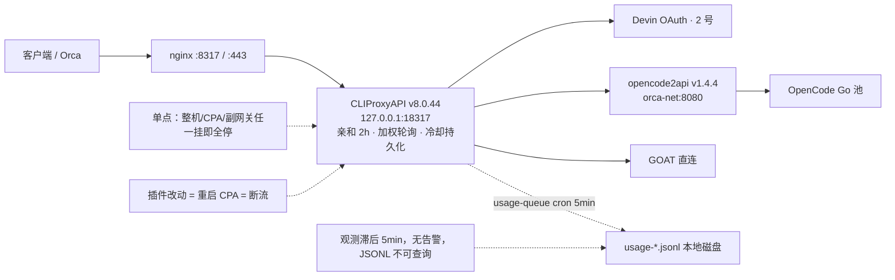
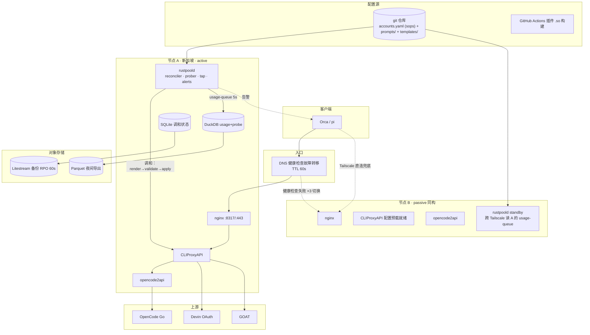
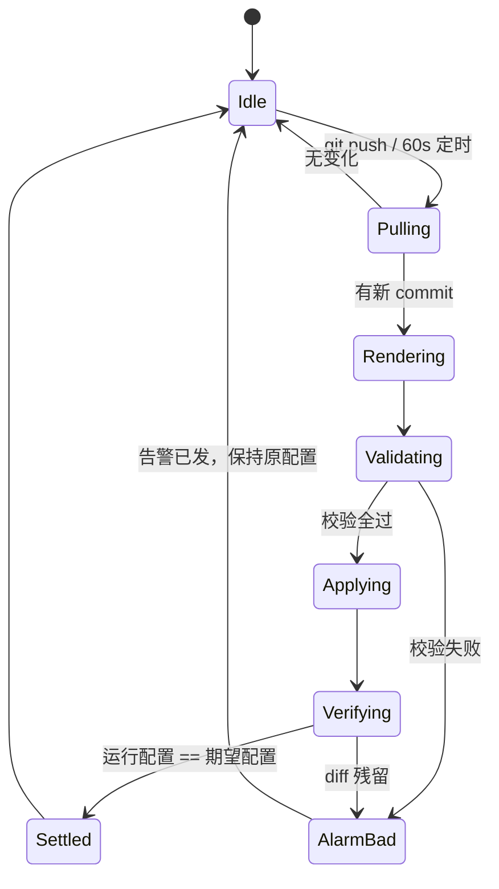
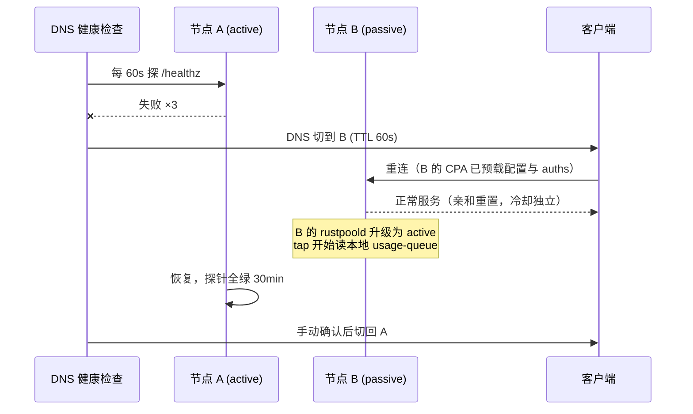
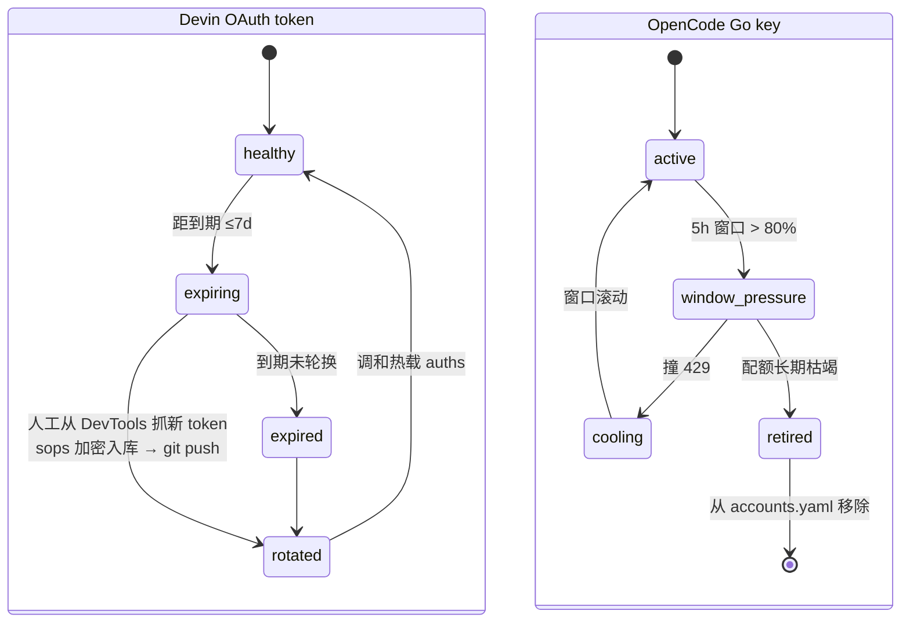

# v3 号池架构设计

> 状态：设计稿，2026-11-19。基线是 CPA v8.0.44 在生产机上的实测现状（SSH 勘察 + 管理端点实测 + 上游文档核对）。落地按第 10 节路线图分四期推进，P0 不动请求路径、零断流风险。

## 1. 现状基线（v2）与痛点



实测基线（2026-11-19 勘察）：

- 单节点 2C/1G（AMD EPYC 7K62，1G 内存仅剩约 70M 空闲），新加坡，Tailscale 接入。
- 数据面健康：CPA 容器 30h 前重启过一次，opencode2api 连续 11 天健康。
- 缓存命中是收入模型的核心：抽样一条 11-19 的请求，56,547 input tokens 中 55,680 走 cache read（98.5%）。
- 用量会计 v2 已经很富（token 分桶、cache_read、session_id、provider、失败详情），但被 cron 5 分钟轮询拉成 JSONL 落盘。
- CPA 的 v8 管理端点已在部署版本可用（GET /v8/management/config 实测 200；PATCH 待真实验证）。

痛点清单（每条都有现场证据）：

| # | 痛点 | 证据 | v3 对应组件 |
|---|---|---|---|
| 1 | 全链路单点，无故障转移 | CPA 30h 前重启即整池中断 | 双节点 + DNS 故障转移（第 5 节） |
| 2 | 配置漂移，人肉 rsync | 服务器跑着本地未提交的 glm-5.3；本地已提交的隐藏裸模型在服务器未生效；服务器上有 7 份 poolctl.py.bak、3 份 accounts.yaml.bak | GitOps 调和器（第 4 节） |
| 3 | 观测滞后且无告警 | cron 5min + 无索引 JSONL；额度烧穿只能事后发现 | usage-tap + DuckDB + 告警（第 6 节） |
| 4 | 插件改动断流 | C ABI .so 仅启动时加载 | 滚动重启编排（第 4.4 节） |
| 5 | 凭据生命周期靠人 | Devin token 过期才被发现；Go key 撞 5h 窗口无预警 | credential-keeper（第 7 节） |
| 6 | secrets 不受版本控制 | accounts.yaml 被 gitignore，回滚靠 .bak 文件 | sops+age 加密入库（第 7.3 节） |
| 7 | 无持续探活 | 冒烟验证靠人工 curl，上游坏了用户先发现 | prober 合成请求（第 4.5 节） |
| 8 | 用量数据泄漏密钥 | 现有 JSONL 把客户端主 key 与上游 key 明文落盘 | tap 默认脱敏（第 6 节） |

## 2. 设计目标与原则

| 目标 | v3 落点 |
|---|---|
| 高效 | 数据面不动（CPA 是 Go 单二进制）；控制面 Rust 常驻，预估内存 <50M；观测从 5min 批处理变 5s 流式 |
| 简洁 | 交付物收敛为三个：rustpoold 单二进制、accounts.yaml 单事实源、B 节点同构栈；cron 与手工 runbook 全部下线 |
| 高可用 | 双节点 active/passive，DNS 健康检查故障转移 + Tailscale 直连兜底，RTO ≤ 3min |
| 可定制 | 新上游 = 配置项；提示词 = profile manifest；插件 = CI 构建 + 滚动上线；git push 即部署 |
| 前沿 | Rust + tokio + axum；SQLite + Litestream 流备份；DuckDB 嵌入式分析；声明式调和循环 |

核心原则一句话：**数据面保守（CPA 不动），控制面与观测面激进（全 Rust 重写）。**

理由：CPA 最难的三块——Devin OAuth 流、加权亲和与冷却调度、request-scoped-errors 重试策略——是上游数千 issue 磨出来的，重写等于重新踩一遍别人踩过的坑。自研收益集中在 CPA 没做、且对号池价值最高的三块：生命周期编排、实时观测、多节点拓扑。上游也在朝编排方向演进（Home 模式概念），v3 的 rustpoold 扮演同角色但自包含；若上游方案成熟，第 10 节 P3 有收敛评估的触发条件。

## 3. 总体架构



分面职责：

| 面 | 组件 | 运行位置 | 失败影响 |
|---|---|---|---|
| 数据面 | CPA + opencode2api + nginx | A/B 各一套 | A 挂触发切换；单组件挂有冷却重试兜底 |
| 控制面 | rustpoold | A active / B standby | 调和暂停，数据面继续跑（控制面死亡 ≠ 断流） |
| 观测面 | tap + DuckDB + 告警 | A 主、B 备采集 | 暂时盲视，不影响转发 |
| 状态面 | SQLite + Litestream | A | 丢失最近 60s 调和日志 |
| 配置源 | git 仓库 + CI | GitHub | 无法发新配置，运行配置不受影响 |

控制面死亡不影响数据面——这是刻意的：rustpoold 是旁路进程，不在请求路径上。CPA 对它只暴露管理端点。

## 4. 控制面：rustpoold

单个 Rust 二进制（musl 静态链接，scp 即部署，systemd 托管），模块分解：

```text
rustpoold
├── git-source         # git pull --ff-only，监听配置源变化
├── render             # P1: 调 python3 poolctl.py render；P2: serde_yaml 原生移植
├── validate           # compose config -q · YAML 解析 · auths schema · render diff
├── apply              # 三档应用机制（见 4.3）
├── prober             # 合成请求探活，per (上游 × 模型)
├── usage-tap          # usage-queue → DuckDB，5s 流式，脱敏
├── credential-keeper  # Devin token 到期探测 · Go quota 窗口预测
├── alerts             # 规则引擎 → ntfy/Telegram
└── api                # axum: /healthz /metrics /v1/status
```

### 4.1 调和循环



Validating 挡的是配置漂移：今天勘察发现的"服务器跑着未提交的 glm-5.3"这类状态在这里被结构性消灭。

### 4.2 防漂移的关键一步

Verifying 阶段把 render 产物与 GET /v8/management/config 的运行时配置做语义 diff（YAML 规范化后比较），不一致即告警并重试 apply。这一步把"仓库正本"和"运行真相"锁死——v2 里那种本地提交了隐藏裸模型、服务器却还在暴露的事故，在 v3 结构上不可能发生。

### 4.3 apply 三档机制

| 改动类型 | 应用方式 | 断流代价 |
|---|---|---|
| CPA 普通配置（路由/权重/密钥/模型表） | 文件写入触发热载，或 PATCH /v8/management/config | 零 |
| auths 凭据文件 | 写入 auth-dir，CPA 文件监听自动生效 | 零 |
| 插件 .so / 插件配置 | 滚动重启（见 4.4） | 单节点夜间窗口约 10s；双节点零断流 |

### 4.4 插件滚动重启编排

双节点时：nginx 把本节点从 upstream 摘除 → 等 in-flight 完成（上限 180s，覆盖长流式）→ restart CPA → /healthz 通过 + 探针通过 → 回挂 → 换下一节点。单节点（P1 阶段）：固定深夜窗口执行，接受约 10s 断流。

### 4.5 prober 探针

每 10min 对每个 (上游 × 模型) 发一条真实小请求（Devin swe-2 一条 8-token ping；Go 一条 16-token）。探针走独立 client key，不占主 key 的亲和会话。结果写入 DuckDB（延迟/成败/首字延迟），同时作为故障转移与滚动重启的健康门。日均成本：Devin 走免费额度，Go 消耗 <5k tokens/天，忽略不计。

## 5. 高可用拓扑

| 项 | 决策 | 理由 |
|---|---|---|
| 拓扑 | active / passive | 亲和与冷却状态是 CPA 进程本地的（上游文档明确：加权 credits 重启即重置），双活收益低于复杂度 |
| B 节点规格 | 1C/1G 即可（约 $5/月）或家里 Tailscale 常开盒 | passive 只需承载切换后的流量，2 用户规模 1C 足够 |
| 故障转移 | DNS 健康检查（60s × 3 失败切 B）+ Tailscale 直连兜底 | 客户端本来就在 Tailscale 里——公网 DNS 出问题时直连 B 的 100.x 地址:8317，第二通道零额外依赖 |
| 切回 | 手动触发（A 探针全绿 30min 后） | 防抖动 |
| 证书 | 双节点各自 ACME DNS-01（P2），Tailscale 路径无需 TLS | 现有自签证书链不动，P2 再迁 |



状态同步矩阵：

| 状态 | 同步方式 | 切换后影响 |
|---|---|---|
| 配置 / 提示词 / auths | git pull → render（幂等，两节点各自跑） | 无 |
| 冷却 / 会话亲和 | 不同步（进程本地） | 短时 429 重冷却，分钟级自愈；额度窗口是账号级的，最终一致 |
| 用量数据 | 各节点各自 DuckDB；B standby 时跨 Tailscale 读 A 的 usage-queue 保持分析连续 | 可容忍的缺口 |
| 调和状态 | SQLite + Litestream → 对象存储，RPO 60s | 丢最近 60s 调和日志 |

## 6. 观测面

### 6.1 采集

usage-tap 每 5s 轮询 /v0/management/usage-queue（沿用现有去重键 request_id+timestamp），写入 DuckDB。**默认脱敏**：客户端 key、上游 key 先 SHA-256 截断再入库（修掉现状 JSONL 明文存两个 key 的问题）。

### 6.2 DuckDB 表结构（对应会计 v2）

```sql
CREATE TABLE usage (
  ts TIMESTAMPTZ, request_id VARCHAR, session_id VARCHAR,
  model VARCHAR, alias VARCHAR, provider VARCHAR, endpoint VARCHAR,
  input_tokens BIGINT, output_tokens BIGINT, reasoning_tokens BIGINT,
  cache_read BIGINT, cache_creation BIGINT, total_tokens BIGINT,
  latency_ms INT, ttft_ms INT, failed BOOLEAN, reasoning_effort VARCHAR,
  client_key_hash VARCHAR, upstream_key_hash VARCHAR
);
CREATE TABLE probes (ts TIMESTAMPTZ, provider VARCHAR, model VARCHAR,
  ok BOOLEAN, latency_ms INT, ttft_ms INT);
```

单写者约束：rustpoold 独占 DuckDB 文件；查询走只读连接或夜间 Parquet 导出。

### 6.3 告警规则（首批）

| 规则 | 窗口 / 阈值 | 动作 |
|---|---|---|
| 缓存命中率塌陷 | 1h 滑窗 cache_read/input < 60% | 告警（亲和被打破） |
| Go key 撞墙预测 | 5h 窗口用量 > 80% | 提醒补号 |
| Devin 计费突变 | swe-2 未计费 token 量环比 -50% | 告警（白嫖窗口关闭的早期信号，对应容量文档开放问题） |
| 冷却风暴 | 10min 内 ≥3 号进冷却 | 风控告警（可能被盯上） |
| ttft 恶化 | p95 同比 ×2 | 上游劣化提示 |
| token 到期 | Devin token ≤7 天 | 轮换提醒 |
| 探针失败 | 连续 2 轮 | 上游故障（触发转移判据之一） |

### 6.4 查询面

/metrics 输出 Prometheus 文本（命中率、烧钱速率、冷却数、探针延迟）；/v1/status 输出 JSON 面板数据。是否上 Grafana 由查询频率决定——单人查询场景，curl + 小页面够用就不加组件。

## 7. 凭据生命周期



### 7.1 Devin 探测

credential-keeper 每小时对每个 Devin auth 发一条 8-token 探针：401/403 即过期，成功即续期校验。到期时间从 CPA 管理端点的凭据元数据读（读不到就按探针成败推断）。轮换本身保留人工环节（Devin 登录有验证码，自动化不可靠）；自动化的是"发现→告警→入库→热载"这条链。

### 7.2 Go 窗口

quota 数据已有（opencode-go-quota 插件逐 key 余量），rustpoold 旁路轮询该数据做窗口预测，不进请求路径。

### 7.3 secrets 入库

accounts.yaml 用 sops + age 加密后入库（.gitignore 摘除现有排除）；渲染时 sops -d，明文只存在于节点内存与 0600 产物。轮换历史进 git，回滚从 .bak 文件变成 git revert。

## 8. 可定制性与扩展点

| 想定制什么 | 动哪里 | 生效路径 |
|---|---|---|
| 新上游（OpenAI 兼容） | accounts.yaml 加一段 | git push → render → 热载，零重启 |
| 新提示词 profile | prompts/manifest.yaml | 同上（插件配置，需滚动重启，双节点零断流） |
| 权重 / 冷却 / 亲和参数 | accounts.yaml → render | 热载 |
| 破甲强度 | manifest 的 overlay 层 | 同 profile |
| 新插件 | plugin/ + CI 构建 .so | 滚动重启 |
| 告警规则 | alerts 规则表（配置文件） | rustpoold 热载自身规则 |

新上游接入的完整步骤（OpenAI 兼容类）：accounts.yaml 填 key 与模型表 → poolctl 模板加 openai-compatibility 段 → push → 60s 内上线。Devin 类 OAuth 上游依赖 CPA 原生支持，跟 CPA 版本走。

## 9. 技术选型

| 位置 | 选择 | 弃用 | 理由 |
|---|---|---|---|
| 控制面语言 | Rust + tokio + axum | Go / Python 常驻 | 单二进制 musl 静态链接；常驻内存预估 <50M，1G 节点装得下 |
| 状态存储 | SQLite + rusqlite | PostgreSQL | 零守护进程；Litestream 流备份，RPO 60s |
| 分析 | DuckDB | ClickHouse | CH 控制面吃内存远超 1G 预算；单文件列存 + SQL 对日千级请求绰绰有余 |
| 备份 | Litestream + 夜间 Parquet | 双主复制 | SQLite 单写者模型简单可靠；分析数据丢失可容忍 |
| 采集 | 轮询 usage-queue 5s | 日志文件解析 | 队列已是结构化 v2 会计，零解析成本 |
| 配置应用 | 文件热载 + v8 PATCH | 只重启 | 热载零断流；PATCH 是降级路径 |
| 故障转移 | DNS 健康检查 + Tailscale 直连 | keepalived/VRRP | 节点跨机房跨家，无共享 L2；客户端已在 Tailscale，天然第二通道 |
| secrets | sops + age | Vault | 无守护进程，git 原生工作流 |
| 入口 | 保留 nginx | Caddy（P3 再评估） | 现有限流配置已验证；范围纪律 |
| 编排 | docker compose + systemd | k3s | k3s 控制面约 300M 内存，1G 机器直接出局 |

## 10. 路线图

| 期 | 范围 | 验收 | 风险 | 工作量（估） |
|---|---|---|---|---|
| P0 | usage-tap + DuckDB + 三条告警（命中率/撞墙/冷却风暴）+ Devin 到期探测；下线 cron | DuckDB 出日请求量；人为压阈值触发三条告警；cron 停用 | 零——纯旁路，不碰请求路径 | 2–3 天 |
| P1 | rustpoold 骨架：reconciler + validate + apply + prober + drift 告警；accounts.yaml sops 化 | git push 后 60s 内生效；故意推错配置被 validate 挡住；render diff 与运行配置一致 | PATCH 端点行为待真实验证（已测 GET 200） | 约 1 周 |
| P2 | B 节点 + DNS 故障转移 + Tailscale 兜底 + 插件滚动重启 | kill CPA 容器，RTO ≤3min；滚动重启期间长流式请求不中断 | B 节点 Go 出口 IP 不同，切换后连接复用重建（可接受） | 3–5 天 + 采购 |
| P3 | 渲染逻辑 Rust 原生化（去 Python 运行时）；Caddy/ACME 评估；上游 Home 模式收敛评估 | 节点上无 python3 依赖 | 移植约 400 行渲染逻辑需对齐现有 tests/ 全绿 | 按需 |

P0 先行的理由：价值最高（立刻能看见烧钱与命中率）、风险为零（旁路）、且是 P1/P2 的地基（prober/tap 代码复用）。

## 11. 不做清单

| 不做 | 一句话理由 |
|---|---|
| k8s / k3s | 1G 内存预算装不下控制平面 |
| ClickHouse / Kafka / Redis | 没有 10 QPS 以上流量与排队场景 |
| 双活数据面 | 亲和/冷却是进程本地状态，双活的复杂度买不回收益 |
| 自研 Rust 网关替代 CPA | OAuth 流 + 调度 + 错误策略是上游磨出来的；重写触发条件：上游停摆 6 个月以上或授权模型不可用 |
| Vault / 服务网格 / eBPF | 没有对应的问题在 |

## 12. 风险与开放问题

1. **PATCH /v8/management/config 在 v8.0.44 的行为**：空请求体实测 500，语义待真实变更验证（P1 第一件事）。文件热载是兜底，不阻塞。
2. **CPA 升级节奏**：v8.0.44 → 更新版本有 config 布局变化风险，升级走 render diff + tests/ 全绿 + 低峰窗口。
3. **DuckDB 单写者**：查询与写入争用时走只读连接或导出，P0 的查询频率下不构成问题。
4. **Go 风控与 B 节点出口**：failover 后所有 key 换出口 IP，direct 模式的号数上限逻辑按新 IP 重新评估。
5. **Devin 白嫖窗口关闭**（容量文档的开放问题）：观测面的"计费突变"规则是早期预警，不是解法；解法仍依赖池子多元化。
6. **探针的亲和污染**：探针用独立 client key 已隔离；若 CPA 按账号而非按 client key 记亲和，需要给探针单独配低频调度（P0 验证）。
